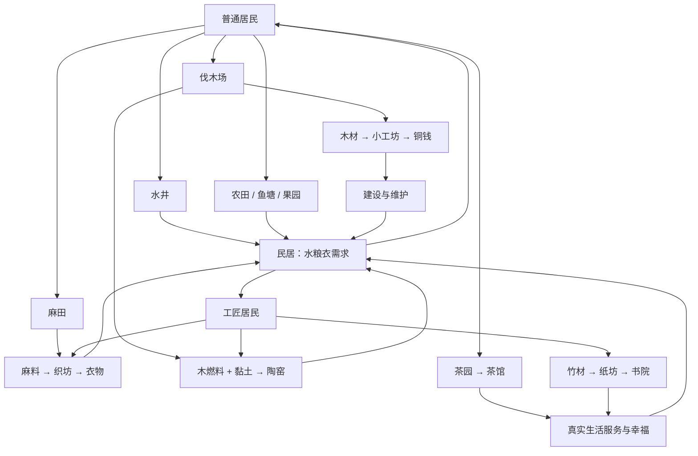

# 东境：居民需求与产业循环数值方案 V3

**状态：V3完整策划提案，待实施。2026-10-22。用户已明确要求的“匠户饮水、粮食是农户两倍”已单独落实；除此之外，本方案的产量、衣需、收入、建造价格、升级条件和阶段目标均未上线。**

本稿基于当前 `SettlementEconomy.gd` 的 26 类建筑和 `Main.gd` 的七地区流程。已经实现的水井、匠户双倍水粮、普通农户衣物需求、初始衣物 12、缺衣缓慢离开、仓库无需劳力及取消运力均应保留。表格中未特别标注调整的建筑成本、占地和人手沿用现状。计算按满员、接路、正常天气、无仓满、实际有消费者计，均为**提案静态模型**，不是当前实机通关报告。

## 1. 要解决的问题与设计取舍

当前主要问题不只是成本低，而是“某个库存够多”不能证明聚落能继续发展。升匠户应同时增加口粮、饮水和衣物需求，并减少普通劳力；开拓应让种粮、种麻、织衣与公共服务争夺同一批人；后期木材应同时用于建造、工坊和烧窑。玩家看到瓶颈后有两三条可选解决路径，而不是照建筑清单依次放满。

本方案不增加运力，不要求逐栋选择配方、停产开关、供货开关或优先级。房屋依旧不占劳力。仓库只有接路、容量与维护。仍由玩家摆建筑、接道路、选择食物来源和升级部分民居。

可供校准的四项约束：

1. 每阶段至少一个核心供给的余量接近 **0—30%**；正常操作总体现金仍为正。
2. 一次升级四人匠户会确定增加 **水 2、粮 2、衣 1／日**，普通劳力减少 4、工匠增加 4。升级预览必须先显示后果。
3. 开拓前保留 **1—2 日生活物资**，不是等待固定日期。目标满足立即可开拓。
4. 让更好的食物来源、更多普通居民、更多工匠或更少公共设施成为真实选择；不要求 26 类建筑全建。

## 2. 统一单位、初始资源与计算口径

- 1 游戏日 = 60 模拟秒；1 座民居最多 4 人；1 居民提供 1 名对应劳力。
- 所有产耗表以“每日”计。模型保留精确小数量，玩家界面使用整户、两日单位表达，例如“农户每 4 人每天衣物 1”。不要逐次向下取整实际消费。
- 推荐新局发放：木材 **140**、粮食 **48**、饮水 **48**、衣物 **12**、铜钱 **72**，人口 **4**。
- 已付初始民居成本后：木材 **128**、铜钱 **68**；其余不变。当前实际是原始木 120、粮 40、水 40、衣 12、币 60；本节增加的储备待实施。
- 初始衣物只有新局／重置发放。加载旧档不补钱、不补衣、不重复赠资源。
- 经济计算以本区库存为基础；顶部库存和容量均只汇总已连通地区。断路仓库或拆仓导致真实溢出时保留货物，并说明原因，不伪造容量。

通用算式：

`净产 = 实际生产 − 居民实际消费 − 建筑实际原料/燃料消耗`

`日净铜 = 农户税 + 匠户税 + 实际衣物收入 + 实际陶器收入 + 实际茶饮收入 + 工坊收入 − 全部建筑维护`

消费收入只在货物实际被消费时结算，不能同时在织坊出货、运抵仓库和居民消费时重复收钱。

## 3. 居民阶层：升级不是无代价增加税收

### 3.1 推荐参数

| 每座住满 4 人的民居／日 | 农户 | 匠户 | 当前到提案的变化 |
| --- | ---: | ---: | --- |
| 普通劳力 | 4 | 0 | 不变 |
| 工匠 | 0 | 4 | 不变 |
| 饮水 | 2 | **4** | 已落实：农户2、匠户4 |
| 粮食 | 2 | **4** | 已落实：农户2、匠户4 |
| 衣物 | **1** | **2** | 当前分别 0.5／1，提案均翻倍 |
| 陶器 | 0 | 0.5 | 北关 L5 开放后才成为改善需求；此前不索要 |
| 基础铜钱 | 2 | **4** | 农户不变；匠户改为明确固定税，不另叠原有供衣税奖励 |
| 衣物全满足收入 | 1 | 2 | 每件衣物收入由当前 2 改为 **1** |
| 陶器全满足收入 | 0 | 1.5 | 每件实际消费收入 3 |

匠户基础税 4 替代旧规则“基本税 2 + 供衣税最多 2”，不是两种税相加。衣物需求翻倍、每件收入减半，因此供好衣后的每人衣物收入与当前一致，避免通过增大需求反而把中后期变成印钱。

每人公式：若普通居民 F、匠户居民 A：

- `饮水需求 = 粮食需求 = 0.5F + A`
- `衣物需求 = 0.25F + 0.5A`，普通农户仅在 L1 解锁后计入。
- `陶器改善需求 = 0.125A`，仅 L5 后。
- `基础税 = 0.5F + A`
- 衣物收入 = 实际领取并消费的衣物数量 × 1；衣物不是拿去卖单。

### 3.2 迁入与升级

迁入保持每 **30 模拟秒最多 2 人**，不恢复两分钟等待。要求有接路空床、水粮当前供足、幸福至少 55、生活库存至少覆盖新增人口后的 1 日。短期缺衣不立即阻迁入；长期缺衣按第 6 节处理。

普通民居升匠户推荐 L1 开放后可用；四人住满、接路、幸福至少 60，建设用木 **18**、铜 **12**，建设 **1 游戏日**。当前为木 12、铜 8、幸福 55且故地即可升级；本节为待实施调整。改建期间仍提供原来的普通劳力，完成当日一次转换，避免建设中把农林一起停掉。

升级预览显示 `普通 −4、工匠 +4；每日水 +2、粮 +2、衣 +1`，以及升级后两类劳力的缺口。应提示至少预备增量需求两日：水 4、粮 4、衣 2；这些是储备建议，不额外扣除。不得设置“必须先有织坊生产衣物才能得到工匠”的循环条件，初始衣物负责过渡。

**首个完整衣物链建议在 16 人、12 农 4 匠时形成。** 12 人升一户后只有 8 普通，而井 1 + 田 2 + 伐木 2 + 工坊 2 + 麻田 2 已需 9 普通，不能声称这个布局满产。12 人全农可以先开北坡，再补民居到 16 人后改建；初始衣物提供转型窗口。16 人时两织坊用满 4 工匠，日衣物产 8、需 5，有 3 余量。

恢复迁入时，已升级匠户的空位应能自动接纳对应职业的新居民，不要留下“少一名工匠就永远补不满”的住宅。这是待实现的迁入规则完善，不新增居民分配按钮。

## 4. 全部 26 类建筑推荐表

记法：工人“普／匠”；成本“木／铜”，带箭头处为“当前→推荐”；容量和服务均要求接路。纯生产率按满员算，缺人按实际人数比例减产。维护即使缺料仍支出，仓库工人固定为 0。

| 建筑 | 占地 | 解锁 | 建造木／铜 | 人手 | 维护铜/日 | 满负荷每日产出、消耗或服务 |
| --- | --- | --- | ---: | --- | ---: | --- |
| 民居 | 1×1 | L0 | 12／4 | 0 | 0 | 容纳 4 人，日需与税见阶层表 |
| 水井 | 2×2 | L0 | 12／4 | 普1 | 0 | **水16**，当前24；无原料 |
| 农田 | 2×2 | L0 | 18／6 | 普2 | 1 | **粮12**，当前16 |
| 伐木场 | 2×2 | L0 | 22／6 | 普2 | 1 | 木12 |
| 小工坊 | 3×2 | L0 | 38／16 | 普2 | 2 | 木4 → 铜12；独立正常净铜10 |
| 仓库 | 2×2 | L0 | 30／10 → **24／14** | **0** | 1 | 本区各类仓容+300，可叠加；无运力 |
| 麻田 | 2×2 | L1 | 18／6 | 普2 | 1 | 麻8；单一作物，无切换设置 |
| 织坊 | 3×2 | L1 | 38／16 | 匠2 | 2 | 麻4 → 衣4 |
| 集市 | 3×3 | L1 | 45／18 → **30／30** | 普1 | 1 | **32人**集市服务、幸福+4、道路范围24；当前容量24 |
| 鱼塘 | 3×3 | L1 | 40／16 → **32／26** | 普2 | 2 | **粮16**，当前20；地贵、维护高，抗旱可选 |
| 果园 | 3×3 | L2 | 42／14 → **32／24** | 普2 | 1 | **每90秒粮27，均值18/日**；当前均值24 |
| 货运站 | 3×2 | L2 | 38／18 → **28／30** | 普2 | 2 | 本区出发道路运输时间减半、最短2秒、不叠加 |
| 竹林场 | 3×3 | L2 | 32／12 → **26／20** | 普2 | 1 | 竹12 |
| 医馆 | 2×2 | L3 | 52／24 → **36／40** | 普2 | 3 | 服务24人、幸福+8、道路范围18 |
| 休憩亭 | 2×2 | L3 | 24／10 → **18／16** | 0 | 1 | 服务16人、景观充分时幸福+6、范围14 |
| 园林 | 3×3 | L3 | 48／22 → **32／36** | 普1 | 2 | 服务24人、景观对应幸福+4到8、范围18 |
| 茶园 | 3×3 | L3 | 38／18 → **30／28** | 普2 | 2 | 茶8 |
| 书院 | 3×3 | L4 | 68／38 → **44／62** | 普3 | 4 | 基础文化32人幸福+8；满额实际耗纸2/日后可服务48人，范围28 |
| 戏台 | 3×2 | L4 | 48／30 → **30／48** | 普2 | 5 | 文化服务40人幸福+8、范围28；与书院同类不叠加 |
| 粮仓 | 3×2 | L4 | 34／14 → **26／22** | 普1 | 1 | 本区粮食仓容+800；专业粮仓人手暂保留，勿与普通仓库混淆 |
| 茶馆 | 3×2 | L4 | 44／24 → **30／38** | **普1** | 2 | **32人**；满服务实际茶2/日、收入6/日、幸福+6、范围20；当前普2／24人 |
| 造纸坊 | 3×2 | L4 | 48／24 → **40／36** | 匠2 | 2 | 竹6 → 纸6 |
| 码头 | 3×2 | L5 | 52／26 → **36／42** | 普2 | 2 | 激活实际合法水路，按水路距离延迟到货；不生成物资 |
| 采泥场 | 3×3 | L5 | 30／16 → **24／24** | 普2 | 2 | 泥12 |
| 陶窑 | 3×3 | L5 | 56／26 → **44／44** | 匠3 | 3 | 泥6 + 燃料木2 → 陶6 |
| 商栈 | 3×2 | L6 | 70／36 → **44／62** | 普3 | 4 | **提案重做为自动乡集订单：粮4+衣2+茶1+陶1+纸1 → 铜18/日**；当前只是遗留交易能力，无本提案功能 |

商栈是可选后期货物出口。自动从本区取料，缺任一原料按可实现比例减产；不开放买入、不要求手动领单、不替代居民消费。它不计入后面的基准布局，所以没有把尚未存在的收入混进基准净钱。

**集市具体作用：** 是接路的生活服务，增加其实际覆盖居民的幸福，不生产铜钱，不代替道路搬运，不提高仓容和运力，不凭空提高衣物消费。即使不造集市，居民仍正常取用生活物资。推荐其幸福效果再乘以覆盖住户水粮衣中的最低实际满足率，衣需尚未启用时忽略衣物，避免缺货集市仍凭空提供满额幸福；这是待实施的服务关联。覆盖按居民人数结算，重复覆盖不叠幸福；服务人员在建筑中走动与买卖演出应对应已服务人数。

## 5. 链条之间如何互相牵制

### 5.1 基础循环

`普通居民 → 农田/鱼塘/果园 → 粮食 → 居民增长`

`普通居民 → 水井 → 饮水 → 居民增长`

`普通居民 → 伐木 → 建造木 / 小工坊木 / 后期陶窑燃料木`

`普通居民 → 麻田 → 麻料 → 工匠织坊 → 衣物 → 留住普通居民与工匠`

`小工坊铜钱 + 居民真实税费/消费 → 维护和建设 → 新劳力和新产能`

普通劳力并非低级且过剩。升级四人匠户会减少可种粮、种麻、取水的人，同时增加这些物资需求。这比增加一列“高级人口”更能形成规划压力。

### 5.2 后期链与选择

- **陶器：** 采泥 → 陶窑；额外占用木材燃料，木头不再只等于建造。实际匠户消费收入与舒适收益；缺陶仅少改善，不直接阻基础生存。
- **茶饮：** 茶园 → 茶馆 → 实际居民休闲消费。少造大楼无顾客不收钱；同一居民同类服务只计一次，不能靠重复覆盖刷钱。
- **文化：** 竹林 → 纸坊 → 书院扩大文化服务。没有现金回款，是用劳力、维护换幸福与迁入条件的投资。戏台能替代基础文化服务，避免全玩家必造纸链；纸链提供更省文化建筑空间的路线。
- **乡集出口：** 商栈消耗多种末端剩余货物赚钱，给完成生活链之后的盈余一个去处，但会与居民竞争衣物和粮食；居民消费先于出口。

木器 `tools` 是当前遗留货物，V3 不再用它做居民需求或解锁目标，也不新增一条假木器链。清理字段可独立安排，不能把现有库存直接改成铜钱。

## 6. 生活缺口、失败与恢复

| 问题 | 首先发生什么 | 慢惩罚 | 可恢复方法 |
| --- | --- | --- | --- |
| 水短缺 | 真供水率降低，幸福逐渐下滑 | 连续30秒阻迁入，120秒后再每60秒离开1人 | 添井、补普通劳力、修路、跨区到货 |
| 粮短缺 | 实际饥饿，幸福下降 | 沿现饥饿规则慢离开，不能当日人口清零 | 粮田、鱼塘或果园替代；停扩张先恢复基础链 |
| 衣短缺 | 失去实际消费收入和幸福改善 | 每户按缺口累计；3等效日不满阻迁入；5等效日起全城每2日至多离开1人 | 麻田+织坊；调整农匠比例；缺口户真实补货即清零 |
| 木/麻/泥/竹短缺 | 对应加工减产，无免费替代 | 只有生活末端持续缺货才影响居民 | 增原料、跨区分工、降低扩建速度 |
| 茶/陶/纸短缺 | 对应改善和收入减弱 | 不直接触发基础离开 | 允许暂时舍弃可选服务 |
| 铜钱不足 | 建设显示资金不足，维护持续扣除 | 保留铜钱归零失败规则 | 工坊恢复直接收入、减少高维护设施；不增加买卖页 |

衣物离开只扣真正缺衣户，不叠加饥饿/缺水/低幸福离开；仅衣物原因保留最后1名普通劳力及工匠。恢复供衣解除迁入限制、允许空位重新补齐。不因一户匠工短缺强迫重开。

这里“可恢复”指短缺到最终失败之间有明确操作窗口；已经铜钱归零或人口归零仍按现规则结束。界面用红色短因说明，不引入自动借贷或无穷保底钱。

拆除沿用返还一半木材和铜钱，保留规划代价；道路可改、建筑可重排。仓库因产业抢工失效的旧问题不得回归。

## 7. 四个规模的可行布局与净收支

以下是可复算样例，不是玩家任务清单。单位均为每日；道路维护0，民居维护0，未列公共设施视为未建。区域内服务覆盖满足时按实际人数计，地图摆放测试仍须单独验证范围。

### 7.1 布局与劳力

| 样例 | 人口结构 | 建筑配置（民居另列） | 普通使用/总量 | 工匠使用/总量 |
| --- | --- | --- | --- | --- |
| 12人，L0 | 12农0匠，民居3 | 井1、田1、伐木1、工坊1、仓库1 | 7/12 | 0/0 |
| 24人，L1+ | 16农8匠，民居6 | 井2、田2、伐木1、工坊1、麻田1、织坊2、集市1、仓库2 | 13/16 | 4/8 |
| 40人，L4 | 28农12匠，民居10 | 井2、田3、伐木2、工坊2、麻田2、织坊4、集市2、茶园1、茶馆2、医馆1、仓库2 | 28/28 | 8/12 |
| 60人，L5+ | 40农20匠，民居15 | 井3、田4、伐木2、工坊2、麻田3、织坊6、集市2、茶园1、茶馆2、医馆1、采泥1、陶窑1、竹林1、纸坊1、书院1、仓库3 | 40/40 | 17/20 |

40人样例选择茶饮和健康，不建造纸链；60人样例展示茶、陶、纸全部连接，但仍未建鱼塘、果园、园林、戏台、粮仓、货运站、码头和商栈。后者均应有用途，但不能都成为通关必建项。

24人样例提前准备8工匠，不意味着最优比例。20农4匠也能运行2织坊，水粮需求少2、衣需少1、基础税少2，普通空闲更多；等需要纸坊或额外织坊时再升级更稳妥。

### 7.2 正常天气日净产

| 资源：产出 − 消耗 = 净值 | 12人 | 24人 | 40人 | 60人 |
| --- | --- | --- | --- | --- |
| 水 | 16−6=**+10** | 32−16=**+16** | 32−26=**+6** | 48−40=**+8** |
| 粮 | 12−6=**+6** | 24−16=**+8** | 36−26=**+10** | 48−40=**+8** |
| 木 | 12−4=**+8** | 12−4=**+8** | 24−8=**+16** | 24−8−2=**+14** |
| 麻 | 0 | 8−8=**0** | 16−16=**0** | 24−24=**0** |
| 衣 | 未启用农户需求，库存12 | 8−8=**0** | 16−13=**+3** | 24−20=**+4** |
| 茶 | 0 | 0 | 8−2.5=**+5.5** | 8−3.75=**+4.25** |
| 泥 | 0 | 0 | 0 | 12−6=**+6** |
| 陶 | 0 | 0 | 0 | 6−2.5=**+3.5** |
| 竹 | 0 | 0 | 0 | 12−6=**+6** |
| 纸 | 0 | 0 | 0 | 6−2=**+4** |

24人衣物正好平衡，新增两位农户会把每日需求升至8.5，初始库存不能当作永久产能。40人水和衣余量约23%，普通劳力全用满；60人水粮衣余量均20%，普通劳力全用满。麻料净0并非失败：它是同步加工投入；缺料时可用预存麻料或末端衣物缓冲。

### 7.3 铜钱逐项验算

| 每日铜钱 | 12人 | 24人 | 40人 | 60人 |
| --- | ---: | ---: | ---: | ---: |
| 基础税 | 6 | 16 | 26 | 40 |
| 实际衣物消费收入 | 0 | 8 | 13 | 20 |
| 小工坊毛收入 | 12 | 12 | 24 | 24 |
| 茶饮实际收入 | 0 | 0 | 7.5 | 11.25 |
| 陶器实际收入 | 0 | 0 | 0 | 7.5 |
| 建筑总维护 | 5 | 13 | 32 | 51 |
| **日净铜** | **+13** | **+23** | **+38.5** | **+51.75** |

60人茶饮不能按两座茶馆都满32人算12铜，实际60人耗茶 `2×60/32=3.75`，收入11.25。书院纸收入为0。陶窑产6但只有2.5真实消费，不能把6全算成消费收入。

允许成功城镇现金宽裕，不能为难而让所有资源同时长期亏损。后期重点压力转为普通劳力、升级后的生活供给、木材用途和真实服务距离。

### 7.4 建设资本与节奏，不能只看日净值

下表包含全部样例建筑、住宅和按木18铜12计算的匠户改建，不含道路、开拓、经营过程已花的维护和拆建损失；不是一开始就需要付清的资金。

| 样例 | 推荐总建造木 | 推荐总建造铜 | 建筑占地格数（不含道路） |
| --- | ---: | ---: | ---: |
| 12人 | 150 | 58 | 25 |
| 24人 | 400 | 186 | 65 |
| 40人 | 794 | 454 | 133 |
| 60人 | 1216 | 746 | 208 |

24→40的样例木本差394、铜本差268。若冻结24人的旧产能日净木8、铜23，单靠积累木约49.25日、铜约11.65日，明确不符合紧凑节奏；不能用“日净全为正”宣布方案已成功。先加第二伐木后，新增木本22、铜6，再到40还需木372、铜262，按新日净木20、铜22作保守静态对照约18.6日和11.91日。这仍不是边建边增长的实际通关时长，必须做动态分批建设验算。

主动建设的中间例：24人先扩成32人、24农8匠，增加第三伐木、第二麻田、第三织坊和第二工坊，配置井2/田2/伐木3/工坊2/麻田2/织坊3/集市1/仓库2。普通使用21/24、工匠6/8，水粮需求20，粮净4、水净12、衣净2、木净28。与冻结24人旧布局相比，可以在继续建造中改变瓶颈，不能把49日静态等待当作固定流程。该中间方案需进一步纳入付费建设顺序验证。

进入40人时普通满岗，继续只加伐木会缺人；需要新普通民居、食物替代或暂缓可选公共服务。在计划路线中提前形成高效食物来源，比建好全部农田后再半价拆掉更便宜。土地面积表不含道路和服务半径，不能代替真实地图可摆放测试。

## 8. 收益、回本与可选路线的机会成本

| 投资 | 定量结果 | 解释 |
| --- | --- | --- |
| 单座工坊 | 毛币12−维护2=净10；木4/日；建设币16现金回本1.6日 | 只算它自身，不假装木材免费；需另有伐木与普通2人 |
| 伐木+工坊完整组合 | 木成本60、币22、普通4；净木8/日、净币9/日 | 分别补回建设木需7.5日、币需2.44日；两种资源不能强行用假市场价合并 |
| 麻田+2织坊 | 木94、币38、普通2工匠4；衣8全消费收入8−维护5=净3 | 现金回本约12.67日，价值主要是保住居民与工匠，而非刷钱 |
| 茶园+1茶馆，32人全覆盖 | 推荐币66，收入6−维护4=净2；普通3 | 约33日现金回本；额外价值是幸福，不能按赚钱必建 |
| 茶园+2茶馆，60人覆盖 | 推荐币104，收入11.25−维护6=净5.25；普通4 | 约19.81日现金回本，不按64名虚拟顾客收费 |
| 采泥+陶窑，20工匠居民 | 推荐币68，实际收入7.5−维护5=净2.5 | 约27.2日现金回本，另占燃料木2/日；舒适收益不能忽略 |
| 竹林+纸坊+书院 | 普通5、工匠2，维护7；没有直接现金 | 换文化服务与布局效率，戏台可作为另一条路线 |

以上回本只计算所述新增链自身现金，不扣既有居民税。木材只按实物产出比较，不引入玩家不可用的隐藏售价。

**避免木材成为唯一瓶颈：** 井、田、伐木、麻田、织坊和工坊等基础链成本暂不动；服务与高级设施按上表把部分木本移为铜本，例如集市45木18币改30木30币，医馆52木24币改36木40币，明确花掉发展后更多的铜钱。同时取消原来后期每次开拓一次扣250—390木的强制木材墙，见下一节。后期木收入不够时可以增加伐木，而劳力需要从其它生产中释放：

- 24人基准日净木只有8；主动加第二伐木场需木22铜6和普通2人，普通使用升至15/16，日净木增至20、净铜由23变22。首轮衣物链稳定后这是可选的主动扩建策略，不要只站着等积木。
- 60人基准4农田产48、用8普通。改为1农田+2鱼塘产44、用6普通，仍对40粮需求保有10%余量，释放2普通。
- 释放的人可以给额外伐木场，日净木从14升至26；或给货运站改善远区配送，不能二者都免费获得。
- 若从旧3农田拆换2鱼塘，半价木退款27，新鱼塘推荐木64，再加伐木22，净追加木59；多出的木12/日约4.92日补回这笔木投入。维护增加2/日，铜净相应下降。
- 果园平均粮产更高，可节约人手，但第一次90秒才收获，必须先备口粮，不用“站着等收成”骗过供给检验。

这类替代改变劳力、土地、现金与缓冲，而不是简单把同一建筑升级成所有方面更好。

## 9. 七阶段目标、开拓支出与难度坡度

本表是**替换当前目标的提案**，不与现有90→480木的目标叠加。目标以人口、幸福、末端资源储备和供需校验组成；不出现建筑数量、固定日数等待或每次重算的浮动目标。供需率用当前实际接路、实际人手的可实现日供给除以日需求，禁止使用库存消耗制造假产能，也禁止把名义满员产量当真实产能。

| 所处阶段→下一步 | 人口/幸福 | 末端储备：水/粮/衣/铜 | 供需校验 | 开拓木/铜 | 主要新决策 |
| --- | --- | --- | --- | --- | --- |
| L0故地→L1北坡 | 12／55 | 24／24／不要求／40 | 水粮≥1，日铜净≥4 | 32／16 | 建立吃饭、取水、木→铜循环 |
| L1北坡→L2东麓 | 24／60 | 40／40／8／70 | 水粮衣≥1，日铜净≥4 | 48／28 | 首次农匠分工，衣物从库存转自产 |
| L2东麓→L3高台 | 32／68 | 48／48／12／100 | 水粮衣≥1，日铜净≥6 | 64／40 | 原料分区、果园与道路配送 |
| L3高台→L4东原 | 40／72 | 60／60／20／130 | 水粮衣≥1，日铜净≥6 | 80／55 | 健康、景观与普通劳力取舍 |
| L4东原→L5北关 | 48／76 | 80／80／28／170 | 水粮≥1、衣≥1.05，日铜净≥8 | 96／70 | 茶饮、文化、衣物扩产择优 |
| L5北关→L6新都 | 56／80 | 96／96／40／220 | 水粮衣≥1.05，日铜净≥8 | 112／90 | 陶器、燃料与水路可选分工 |
| L6新都→复兴完成 | 60／82 | 120／120／60／280 | 水粮衣≥1.1，日铜净≥8 | 不再扣开拓费 | 有供给余量、可继续发展的自给城镇 |

开拓不扣生活粮食、饮水和衣物；铜和木才是工程支出。六次开拓合计木432、铜299，当前六次实际开拓木总计1345，提案不再要求同一木材链空转数十日。完成条件与物资扣除前后必须分清，扣费后仍保留表中生活储备。

开拓木／铜费用提前放在开拓入口的tips中，执行时按明确数额扣除；不增加确认步骤，也不作为额外主栏目标。奖励只在开拓弹窗呈现，可用一次性道路接入或小额建设木币返还；不得给足下一阶段衣物生产缺口，把链条绕过去。最初校准先不计奖励收入，验证无赠送也可通关，再决定可选展示奖励。

阶段时间验收目标：首个收入循环2—4分钟，首条完整衣物链6—10分钟；每次开拓后的有效经营决策约4—8分钟，完整普通难度35—60分钟。它们是策划验收范围，不是游戏内等待条件；当前静态计算尚不能证明实机达成这些时间。

## 10. 供需检验不能被库存与跨区计算骗过

- 消费先满足居民，再用于后期乡集订单；一次资源只结算一次。
- 跨区按真实道路或水路延迟到货，无每日运力、点数、配额。货运站只缩短时间，不增加产量。
- 计算某区缺货时，断路挂起的在途货物不抵扣居民需要，但仍预留库位；第三个可达地区可以继续补货。
- 仓库静态储物，其他产业抢工不应让容量消失。粮仓的专业劳力若将来也简化，应另审并同步说明，不悄悄恢复运输系统。
- 目标中的供需率来自连接关系、人员和原料供应共同支持的持续日量；建议按生产依赖图求瓶颈，批次果园按其当前有效劳力折算日量。真实到户不足时仍显示供给不足。
- 原料库存可作短时恢复缓冲，但不能将“只有12衣、无麻田织坊”认作衣物日供给合格。源区发货与目的区收到货不能双重计产量。
- 上述供需模型是待实现项，不能拿当前瞬时净库存变化直接替代。QA需验证断路、批次、跨区、仓满与人口变化边界。

## 11. 普通难度与可选挑战

普通难度先使用本稿基准表，确保基础循环可恢复、早期不被普通/工匠劳力结构锁死。主要难度来自每次升级和扩张改变瓶颈，不能只增加费用。

可选挑战作为后续单独模块，不混入本次基准验算：每8游戏日有6日正常、2日干旱；提前1日天气提示。干旱井、农田、麻田产量为75%，鱼塘不变，不改民居消耗，也不改变NPC表演速度。

60人基准干旱时水36对需40、粮36对需40，各日缺4；两日各需8库存。麻18不足织坊24的投入，若没有麻库存，衣产18对需20，两日需衣物4。正常六日衣物多产24，足以补回衣物缓冲。这个风险让储备和食物替代有用，不能把两日无预警停产当作随机惩罚。

干旱不应要求大量常驻数值条，仅显示天气和预计短缺的提示。普通难度未通过完整流程验收前不启用挑战天气。

## 12. UI、可见成长与验收顺序

上方继续以人口、木材、饮水、粮食、衣物、铜钱和幸福为主，数字使用整数；中间材料留在相关建筑详情。目标按资源逐项标绿，不加进度条、不加“固定”字样、不摆费用长表。

民居只显示状态、整户日需、对应劳力与改建后差异。民居升级外观应明显体现更好的院落与服饰；集市按真实顾客覆盖表现人气；供衣后居民服饰可适度改善；纸足的书院体现活动人数。这些是表现需求，不能假装已制作完毕。

实施顺序：

1. 单独落地阶层需求、收入和升级预览；保留前述已完成仓库/缺衣修复。
2. 接入新产量、集市/茶馆服务与自动补匠户空位，验证16人口首次衣物闭环。
3. 用真实供需校验替换阶段目标，降低强制开拓木材墙；不先提高所有成本。
4. 制作商栈自动末端消费，确认无管理页也能理解；可选链绝不偷偷变成全部必建。
5. 跑付费、零交易、不同食物与服务路线的全流程，再考虑挑战天气。

必须通过的量化验收：

- 12全农、16首匠、24/40/60布局的两类劳力分别守恒；工匠不能顶普通岗位。
- 4人升匠户完成时水粮各+2、衣+1；税不重复增加，改建期间和完成时角色转换只发生一次。
- 24人衣净0，继续增长会出现明确可修的衣缺口；40/60边界能通过替代食物或增加住宅解决，不靠隐藏买卖。
- 所有消费现金只按真实消费计，茶馆覆盖不重算，同类幸福不叠加。
- 衣物恢复可清除慢退并重新补满匠户；饥饿和缺衣不叠加加速清人。
- 每次开拓后库存和容量不重置；断路有保留库存与替代供应，修路后没有重复货物。
- 目标不要求建筑数量和经过日期；无贸易可达最终关卡，至少三种主粮组合和两条幸福路线可过，并允许省略至少20%的非基础建筑类型。
- 记录从目标出现到完成的时间，其中无新决策的纯等待占比应低于25%，单纯等某个存量门槛不应超过2游戏日；关键生活供给中断1日后，合理补救应能在2—4日内恢复。超标优先调整开拓支付、就业效率和替代路径，不直接塞资源。

独立检算见 [V3 数值验算](ECONOMY_BALANCE_V3_VALIDATION.md) 及 `qa/economy-balance-v3/` 配套设计模拟数据。这里的静态样例是可行性证明的一部分，不能冒充地图摆放与实机通关验收。
